<picture>
  <source media="(prefers-color-scheme: dark)" srcset="https://raw.githubusercontent.com/nikhilmalviya26/nikhilmalviya26/main/roles-dark.svg?v=4">
  <source media="(prefers-color-scheme: light)" srcset="https://raw.githubusercontent.com/nikhilmalviya26/nikhilmalviya26/main/roles-light.svg?v=4">
  
</picture>

<picture>
  <source media="(prefers-color-scheme: dark)" srcset="https://raw.githubusercontent.com/nikhilmalviya26/nikhilmalviya26/main/dark.svg?v=4">
  <source media="(prefers-color-scheme: light)" srcset="https://raw.githubusercontent.com/nikhilmalviya26/nikhilmalviya26/main/light.svg?v=4">
  
</picture>

  

<picture>
  <source media="(prefers-color-scheme: dark)" srcset="https://raw.githubusercontent.com/nikhilmalviya26/nikhilmalviya26/output/github-snake-dark.svg?v=2">
  <source media="(prefers-color-scheme: light)" srcset="https://raw.githubusercontent.com/nikhilmalviya26/nikhilmalviya26/output/github-snake.svg?v=2">
  
</picture>

  

&nbsp;&nbsp;
&nbsp;&nbsp;

<h2>👨‍💻 About</h2>

I am a Computer Science and Engineering student and Software Engineer specializing in Java Backend Development, with an interest in designing, developing, and maintaining efficient, scalable, and reliable software applications.

My technical background includes Java, Object-Oriented Programming (OOP), Data Structures and Algorithms, backend development, RESTful API design, and database management. I enjoy implementing backend logic, working with databases, and building structured solutions to real-world engineering problems.

Alongside backend development, I work with modern web technologies, including JavaScript, React.js, HTML, CSS, and MySQL. I believe in writing clean, efficient, and maintainable code while continuously strengthening my problem-solving skills and software engineering practices.

---

<h2>🎓 Education</h2>

<h3>B.Tech — Computer Science & Engineering</h3>

Sagar Institute of Research & Technology (SIRT), Bhopal

<strong>CGPA:</strong> 7.36 &nbsp; | &nbsp; <strong>Duration:</strong> 2023 – 2027

---

<h2>🛠️ Tech Stack</h2>

<strong>Languages</strong>

<strong>Frontend</strong>

<strong>Backend & Databases</strong>

<strong>Tools & Deployment</strong>

---

<h2 align="center">📈 Contribution Activity</h2>

  

---

<h2>⚡ Technical Expertise</h2>

<strong>Java</strong>

████████████████████

<strong>Object-Oriented Programming (OOP)</strong>

████████████████████

<strong>Data Structures & Algorithms</strong>

██████████████

<strong>JavaScript</strong>

███████████████

<strong>React.js</strong>

██████████████

<strong>MySQL</strong>

███████████████

---

<h2>✦ Open To</h2>

